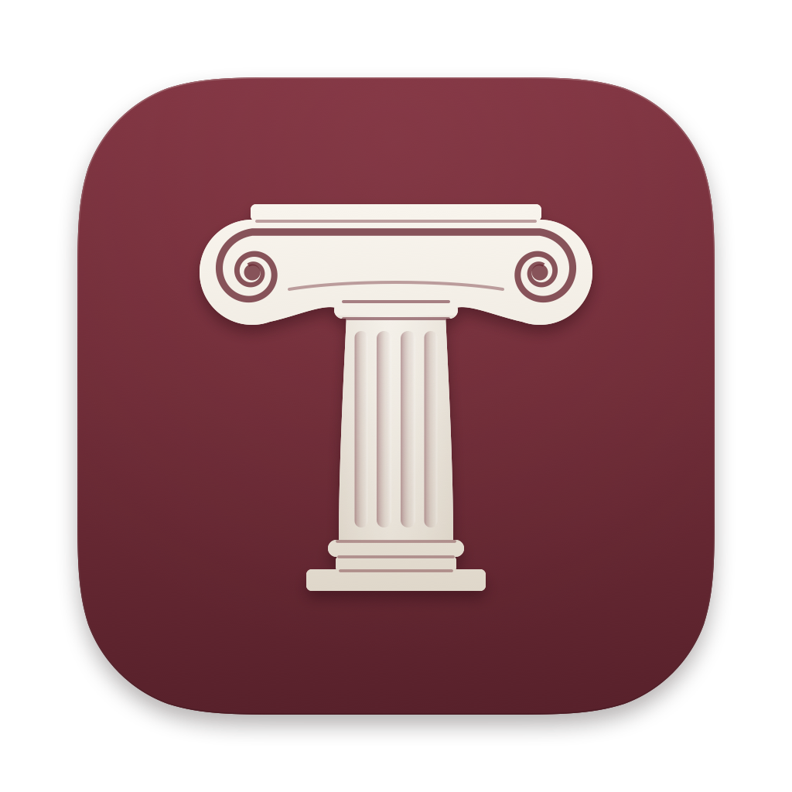

<p align="center">
  
</p>

# Titiz

> **English Overview:** **Titiz** is an open-source, 100% offline, deterministic macOS menu bar utility built for people who write Turkish on an English keyboard. It restores missing Turkish diacritics (`ç, ğ, ı, İ, ö, ş, ü`) and fixes high-confidence Turkish spelling and punctuation mistakes locally with zero cloud calls, zero API keys, and zero generative rewriting. Titiz prioritizes **precision strictly over recall** ("never break what is already correct"), protecting proper nouns, brand names, code identifiers, and English technical terms out of the box.

---

## Proje Amacı

İngilizce (QWERTY) klavyeyle Türkçe yazarken eksik kalan Türkçe karakterleri (`ç, ğ, ı, İ, ö, ş, ü`) ve sık yapılan açık yazım/noktalama hatalarını **tamamen çevrimdışı**, **deterministik** ve **milisaniyeler içinde** düzelten yerel bir macOS menü çubuğu uygulamasıdır.

- **%100 Çevrimdışı ve Gizlilik Odaklı:** Hesap yok, API anahtarı yok, telemetri yok, bulut çağrısı veya yapay zeka (LLM) servisi yok. Tüm metinler yalnızca kendi Mac'inizde işlenir.
- **Hızlı Menü Çubuğu Akışı:** Menü çubuğundan açın, metni yapıştırın (`⌘V`), **"Düzelt"** (`⌘↩`) butonuna basın, isterseniz satır içi değişiklikleri inceleyin ve sonucu kopyalayın (`⌘⇧C`).
- **Son 5 Geçmiş:** Son 5 düzeltme Mac'inizde yerel olarak saklanır ve dilediğiniz zaman tek tıkla yeniden kopyalanabilir.
- **İsteğe Bağlı Manuel Güncelleme Denetimi:** Uygulama açılışta veya metin düzeltirken arka planda hiçbir ağ çağrısı yapmaz; yalnızca Ayarlar ekranındaki **"Güncellemeleri Denetle"** butonuna tıkladığınızda GitHub Releases üzerinden yeni sürüm kontrol edilir ve varsa tek tıkla yüklenir.

---

## Temel İlke: "Doğru Olanı Bozmamak"

Titiz'in en öncelikli mühendislik kuralı **hassasiyeti (precision) her zaman kapsamın (recall) önünde tutmaktır**. Bağlam belirsizse uygulama tahmin yürütmek yerine özgün metni korur.

- **Hedef örnek:**
  - Girdi: `Intel ekibinden MaviKutu icin cevap geldimi?`
  - Çıktı: `Intel ekibinden MaviKutu için cevap geldi mi?`
  - (`Intel` yerleşik koruma listesiyle, `MaviKutu` yapısal CamelCase algılaması ve Kişisel Sözlük ile korunur; `icin → için` ve `geldimi → geldi mi` güvenle düzeltilir.)
- **Özel Adlar ve Teknik Terimler:** `Intel` cümle başında bile `Intel` olarak kalır (asla `İntel` olmaz). `driver`, `feedback`, `"Search"` gibi İngilizce ve teknik ifadeler olduğu gibi korunur.
- **Üsluba Dokunmaz:** Metni yeniden yazmaz veya anlamı değiştirmez (`Gönder` hiçbir zaman `gönderin` yapılmaz).
- **Yabancı Kök + Türkçe Ek Koruması:** `Apple'da`, `iPhone'u`, `GitHub'ta` gibi okunuşa göre gelen Türkçe eklerin ünlü uyumu otomatik değiştirilmez. `loglarini` gibi yabancı kök + ek birleşimleri belirsizse dokunulmadan bırakılır.
- **Kişisel Sözlük ("Bu adı hep koru"):** Herhangi bir sözcüğü veya çok sözcüklü ifadeyi (`MaviKutu`, `Yeni Proje X` vb.) seçip **"Bu adı hep koru"** diyerek anında koruma altına alabilirsiniz. Kişisel Sözlük tüm yerleşik varlık listelerinden daha yüksek önceliğe sahiptir.

---

## Üç Çalışma Modu

1. **`Türkçe karakterler` (Karakter Modu):**
   - Yalnızca ASCII harflerden (`c, g, i, o, s, u`) eksik Türkçe karakterleri (`ç, ğ, ı, İ, ö, ş, ü`) geri yükler (`yarin disari cikacagim → yarın dışarı çıkacağım`).
   - Halihazırda metinde bulunan Türkçe karakterleri asla bozmaz veya geri almaz (tek yönlü garanti). Büyük/küçük harf, noktalama veya sözcük ayırma yapmaz.
2. **`Yazım ve noktalama` (Yazım ve Noktalama Modu):**
   - Yüksek güvenli, deterministik TDK yazım ve noktalama düzeltmelerini uygular (`Bugün toplantı varmı ? → Bugün toplantı var mı?`).
   - **v1 Kapsamı:** Noktalama boşlukları (`? ! , . ; :` öncesi/sonrası; URL, ondalık sayı, kısaltma ve saat ifadeleri hariç), `tr_TR` yerel ayarıyla cümle başı büyük harf (korunan özel adlar hariç), soru eki `mi/mı/mu/mü` ve çekimli eklerinin ayrılması (`ekonomi`, `samimi`, `resmi`, `kimi`, `yirmi`, `acemi`, `ilmi`, `daimi` gibi sözcükler korunarak) ve kapalı küme kesin TDK düzeltmeleri (`herşey → her şey`, `birşey → bir şey`, `hiçbirşey → hiçbir şey`, `herkez → herkes`, `yanlız → yalnız`, `yalnış → yanlış`, `sağol → sağ ol`, `hoşçakal → hoşça kal`, `ardarda → art arda`).
   - **v1 Otomatik Düzeltme Kapsamı Dışı:** Sözdizimsel/anlamsal `de/da`, `ki` ve `kar/kâr` otomatik değişiklikleri hassasiyeti korumak amacıyla v1 kapsamı dışındadır.
3. **`Düzelt` (Birleşik Mod — Varsayılan Tek Tık Eylemi):**
   - Karakter ve Yazım motorlarını birlikte çalıştırır; ayrıca bitişik yazılmış ASCII soru ekleri ve kapalı bileşiklerde **birleşik ayırma ve Türkçe karakter tamamlama** (*joint split-and-deasciify*) uygular (`ciktimi → çıktı mı`, `varmi → var mı`, `gordunmu → gördün mü`, `hersey → her şey`).

---

## Mimari

Titiz, harici `.xcodeproj` dosyası olmadan saf **Swift Package Manager (`Package.swift`)** ile modüler olarak yapılandırılmıştır:

```text
Titiz
├── Sources/TitizApp          # macOS Menü Çubuğu SwiftUI arayüzü (Liquid Glass + AppKit odak köprüsü)
├── Sources/TitizCore         # Saf Swift, AppKit bağımsız deterministik düzeltme motoru
│   ├── Pipeline/             # UTF-8 NFC normalizasyonu, tr_TR locale, yapısal lexer, birleşik akış
│   ├── Protection/           # 4 katmanlı koruma (Tier 0-3), çok sözcüklü trie, Kişisel Sözlük
│   ├── CharacterEngine/      # 3 kovalı aday sınıflandırıcı, tek yönlü GPA skorlayıcı, n-gram ayrıştırıcı
│   ├── SpellingEngine/       # TDK kuralları, joint split-and-deasciify, rules.json
│   └── Models & Resources/   # Modeller, tr_TR.dic/aff, sözlük ve frekans tabloları
├── Sources/CHunspell         # Gömülü C/C++ Hunspell motoru ve C köprü başlığı
├── Sources/TitizEval         # Geliştirme ve kör test seti ölçüm/gecikme CLI aracı
├── Tests/TitizCoreTests      # Birim ve regresyon test paketleri
├── assets/                   # Özel macOS uygulama simgesi (AppIcon.icns) ve README logosu
└── scripts/                  # Çevrimdışı varlık üretimi, simge ve Titiz.app paketleme betikleri
```

---

## Derleme, Geliştirme ve Paketleme

Gereksinimler: macOS (Apple Silicon / Intel), Xcode ve Swift 6+. Harici Node.js veya Python çalışma zamanı son kullanıcılar için gerekmez.

```bash
git clone https://github.com/GorkemSay/Titiz.git
cd Titiz

# Tüm hedefleri derle
swift build

# Birim ve regresyon testlerini çalıştır
swift test

# Değerlendirme CLI aracını çalıştır (Release + eşik doğrulaması)
swift run -c release TitizEval --enforce-gates

# Menü çubuğu uygulamasını geliştirme modunda başlat
swift run TitizApp

# Bağımsız Titiz.app, .zip ve .dmg dağıtım paketlerini oluştur (dist/ altında)
./scripts/bundle-app.sh
```

---

## Ölçülen Kalite ve Gecikme Sonuçları (`TitizEval`)

60 geliştirme/regresyon vakası (`Datasets/dev_cases.json`) üzerinde `Release` derleme sonuçları:

| Ölçüt | Hedef | Ölçülen Sonuç |
| --- | --- | --- |
| Yanlış Pozitif Bozulma (Genel / Temiz Cümleler) | `<= %0,50` / `%0,00` | **`%0,00` (0/340)** / **`%0,00` (0/123)** |
| Özel Ad ve Yabancı Terim Koruması | `>= %99,00` (`Tier 1/2A: %100`) | **`%100,00` (48/48)** |
| Gerçek Hata Yakalama (`Bucket 1` / Genel) | `>= %92,00` / `>= %75,00` | **`%100,00` (70/70)** / **`%99,24` (131/132)** |
| Düzeltme Kesinliği (*Edit Precision*) | `>= %95,00` | **`%100,00` (131/131)** |
| Gecikme `p50 / p95` (273 krk. / 1.926 krk.) | `< 10 ms` / `< 25–80 ms` | **`0,626 / 0,678 ms`** · **`5,719 / 7,366 ms`** |

---

## macOS Sürüm Uyumluluğu ve Simge Notu

- `Package.swift` dosyası dağıtım hedefini `macOS(.v14)` olarak tanımlar. macOS 26 ve üzeri sistemlerde `#available(macOS 26.0, *)` ile yerel Apple Liquid Glass API'leri, macOS 14–15 sistemlerde ise `.ultraThinMaterial` / `.regularMaterial` uyumlu görsel katman kullanılır.
- **Uyumluluk Notu:** macOS 14–15 çalışma zamanı uyumluluğu hedeflenmektedir; ancak doğrudan macOS 14 ve 15 ortamlarında doğrulanana kadar test edilmemiş kabul edilmelidir.
- **Uygulama Simgesi:** Titiz, macOS yuvarlatılmış kare (*squircle*) formunda kırık bordo (`#702D38`) zemin üzerine kırık mermer beyazı (`#EFEAE1`) **T** tipografisiyle tasarlanmış özel uygulama simgesini kullanır ([assets/titiz-logo.png](assets/titiz-logo.png), [assets/AppIcon.icns](assets/AppIcon.icns) ve [scripts/generate-icon.swift](scripts/generate-icon.swift)).

---

## macOS 15+ İmzasız Uygulama Açma (Gatekeeper)

GitHub Releases üzerinden dağıtılan ad-hoc imzalı/imzasız `Titiz.app` paketini ilk kez açarken macOS Gatekeeper güvenlik uyarısı gösterebilir:

1. `Titiz.app` dosyasını **Uygulamalar (`Applications`)** klasörüne taşıyın.
2. Uygulamayı açmayı bir kez deneyin ve uyarı penceresini kapatın.
3. **Sistem Ayarları → Gizlilik ve Güvenlik** bölümünü açın.
4. Alt kısımda görünen `Titiz` engelleme mesajının yanındaki **"Yine de Aç"** düğmesine tıklayıp onaylayın.

---

## Yol Haritası

| Faz | Kapsam | Durum |
| --- | --- | --- |
| Faz 0 | Depo kurulumu, dokümantasyon ve SwiftPM iskeleti | Tamamlandı |
| Faz 1 | Gömülü Hunspell (`CHunspell`), NFC/`tr_TR`, Lexer ve Tier 0 koruma | Tamamlandı |
| Faz 2 | `TitizEval` ölçüm aracı ve veri kümesi altyapısı | Tamamlandı |
| Faz 3 | 3 kovalı Karakter Motoru ve istatistiksel ayrıştırıcı | Tamamlandı |
| Faz 4 | 4 katmanlı özel ad koruması ve Kişisel Sözlük | Tamamlandı |
| Faz 5 | Yüksek hassasiyetli Yazım Motoru ve birleşik `Düzelt` modu | Tamamlandı |
| Faz 6 | Yerel macOS Menü Çubuğu arayüzü (`TitizApp` — Liquid Glass) | Tamamlandı |
| Faz 7 | Paketleme betiği (`Titiz.app`, `.zip`/`.dmg`) ve son kontroller | Tamamlandı |

---

## Lisans ve Üçüncü Taraf Bileşenler

- Titiz kaynak kodu **MIT Lisansı** ile lisanslanmıştır ([LICENSE](LICENSE)).
- Gömülü sözlükler, algoritmalar ve açık veri kümelerinin lisans ve atıf bilgileri [THIRD_PARTY_NOTICES.md](THIRD_PARTY_NOTICES.md) dosyasında tutulmaktadır.
